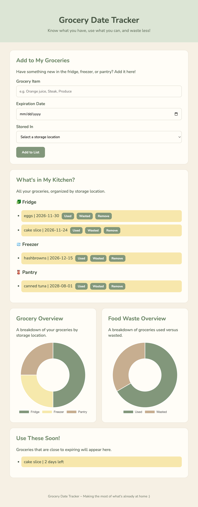

# Grocery Expiration Date Tracker

This project is a simple web application that helps users keep track of their groceries and expiration dates. The goal is to make it easier to see what groceries are still available at home and which ones should be used soon to help reduce food waste.

## Demo Screenshot



## Demo Path

1. Enter a grocery item's name, expiration date, and storage category (Fridge, Freezer, or Pantry).
2. Click "Add to List" to add the grocery to the list.
3. View all saved grocery items and their expiration dates under "What's in My Kitchen?", organized by storage location.
4. Check the "Use These Soon!" section to see which groceries will expire within the next 3 days.
5. View the Grocery Overview chart to see how many groceries are stored in each category.
6. Click "Used" or "Wasted" on a grocery item to remove it from the active list and save its status.
7. View the Food Waste Overview chart to compare how many grocery items were used versus wasted.
8. Click "Remove" to delete a grocery item without counting it as used or wasted.
9. Refresh the webpage to confirm that the grocery list and Used/Wasted history are still saved.

## Current Features

- Add grocery items with a name, expiration date, and storage category.
- Display all added grocery items under "What's in My Kitchen?", organized into separate Fridge, Freezer, and Pantry sections.
- Save grocery items using localStorage so they remain available even after refreshing the webpage.
- Automatically display groceries that are expiring within the next 3 days.
- Show how many days are left before a grocery expires.
- Display a doughnut chart showing the number of groceries stored in the Fridge, Freezer, and Pantry.
- Mark grocery items as Used or Wasted and remove them from the active grocery list.
- Save Used and Wasted grocery history using localStorage.
- Display a Food Waste Overview doughnut chart comparing the number of groceries used versus wasted.
- Remove grocery items from the list without adding them to the Used/Wasted history.
- Prevent users from adding groceries without completing the required fields.
- Require users to select a storage location instead of having one automatically selected.

## Tech Stack

- **HTML**: For the structure and layout of the webpage.
- **CSS**: For styling, organizing grocery items by storage location, and displaying the two charts side by side.
- **JavaScript**: For handling user input, adding and removing grocery items, tracking Used/Wasted history, checking expiration dates, and updating both charts.
- **localStorage**: For saving grocery items and their Used/Wasted history in the browser so they don't disappear when the page is refreshed.
- **Chart.js**: For creating the Grocery Overview and Food Waste Overview doughnut charts.

I chose to use HTML, CSS, and JavaScript to keep the project simple and manageable while still being able to build the features I have planned. Using localStorage also allows me to save grocery information without needing to set up a separate database.

## How to Run

1. Download or clone the repository.
2. Open the project folder in VS Code.
3. Open `index.html` in a web browser with an internet connection to load Chart.js.
4. Enter a grocery item's name, expiration date, and storage category.
5. Click "Add to List" to save the grocery and display it on the webpage.

The grocery list, Use These Soon! section, and Grocery Overview chart will update automatically as new groceries are added. Users can also mark groceries as Used or Wasted, which will update the Food Waste Overview chart.

Grocery items and their Used/Wasted history are saved using localStorage, so the information will remain available after refreshing the webpage in the same browser.

## Quickstart

1. Clone the repository:

   ```bash
   git clone https://github.com/alyannadahilig/grocery-date-tracker.git
   ```

2. Open the `grocery-date-tracker` folder in VS Code.
3. Open `index.html` in your browser to run the application.

No additional installation is required. An internet connection is needed to load Chart.js for the charts.

**Live Demo:** https://alyannadahilig.github.io/grocery-date-tracker/

## Sample Data

The `sample-data.json` file contains four example grocery items: Tomato, Sourdough Bread, Caesar Salad, and Frozen Gyoza.

This file is included for reference only and does not automatically load into the application. Users can refer to the sample data and manually enter the same information into the grocery tracker if they would like to test its features.

## Project Status

The project has completed its third build sprint. The main features are now implemented, including adding and saving grocery items, checking which groceries are close to expiring, and displaying charts for grocery storage locations and Used/Wasted history.

During Sprint 3, I also made improvements based on peer feedback. I updated the storage location dropdown so users have to select a location instead of having one selected by default. I also organized the grocery list into separate Fridge, Freezer, and Pantry sections to make it easier to find items.

Additional features were added, including Used, Wasted, and Remove buttons, along with a Food Waste Overview chart. I also added basic input validation and error handling for when Chart.js fails to load.

The application now has a more complete demo path, allowing users to add groceries, manage their grocery lists, and track how many items were used versus wasted.

## Future Improvements

In future sprints, I would like to add user accounts and a database so grocery information can be accessed across multiple devices. I would also like to improve the Food Waste Overview by adding more detailed statistics, such as tracking food waste over time.
